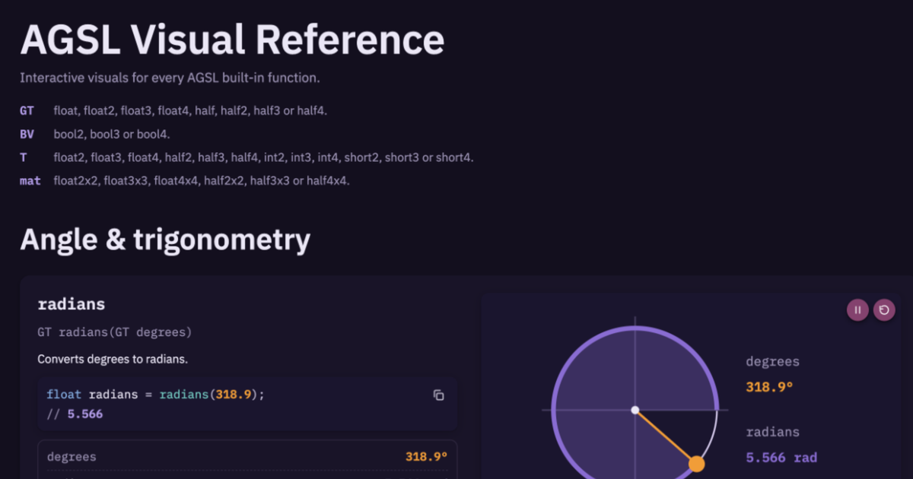

# AGSL Visual Reference

Interactive visual reference for the built-in functions of AGSL, Android's shading language. Each function has an animated, draggable diagram with live values and example code.

**Live:** https://akexorcist.github.io/agsl-visual-reference/

## Reference

[AGSL quick reference](https://developer.android.com/develop/ui/views/graphics/agsl/agsl-quick-reference)

## License

Copyright 2026 Akexorcist. Licensed under the [Apache License 2.0](LICENSE).
